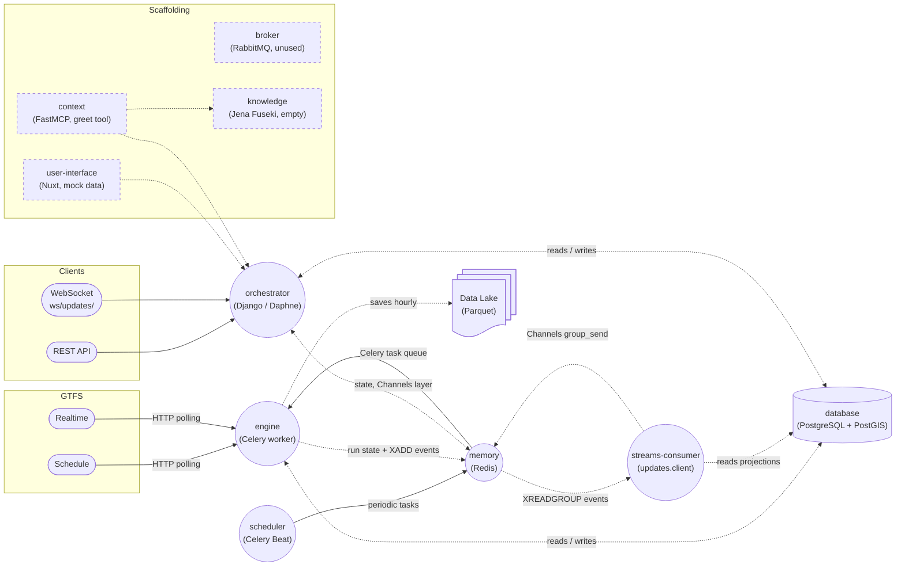

# Infobús Architecture

`backend` is a folder with the codebase for `orchestrator`, `engine`, `scheduler` and `streams-consumer`. It contains the Django project and the Celery Worker, Celery Beat and stream-consumer entrypoints. This way, every process has access to the Django models and utilities.

Solid boxes are implemented. Dashed boxes are provisioned scaffolding with no connected domain path yet.

Redis (`memory`) is the Celery broker, the Channels layer, the store for current run state and the home of the `events` stream. RabbitMQ is provisioned but not used by Celery. Upstream feed URLs are stored in the database on `FeedPublisher` records.
